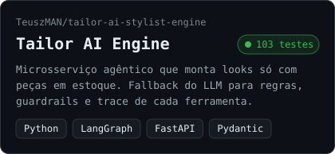
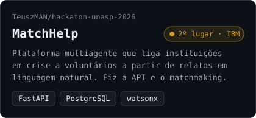
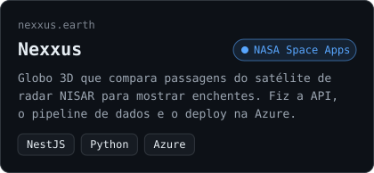
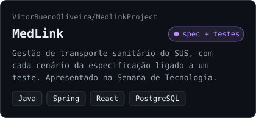
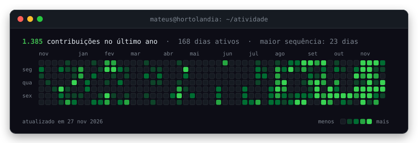

  

 

Sou estudante de Engenharia de Computação no UNASP e estagiário de QA no Instituto Eldorado. Lá, construí com o time agentes de IA no Atlassian Rovo que reduziram em quase 50% o tempo das auditorias de processo, e o trabalho virou [artigo no SBES 2026](https://sol.sbc.org.br/index.php/sbes/article/view/47305).

Hoje meu foco é engenharia de IA: agentes com LangGraph, APIs com FastAPI e, principalmente, avaliação. Para mim, um agente só está pronto quando dá para medir quanto ele acerta.

### `~/projetos`

### `~/stack`

Também uso LangGraph, LangChain, Pydantic e pytest, e desenvolvo com agentes de código (Claude Code, Antigravity, Codex e Hermes) guiados por especificação e testes.

### `~/atividade`

Gerado todo dia pelo workflow <a href=".github/workflows/atividade.yml">Atividade</a> deste repositório.

### `~/contato`

[LinkedIn](https://www.linkedin.com/in/mateus-alves-nunes) · [mateuszman.contato@gmail.com](mailto:mateuszman.contato@gmail.com)
